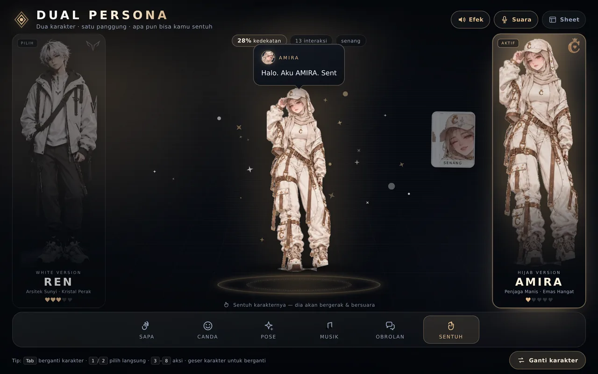
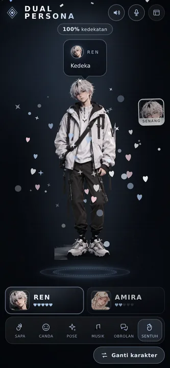

# DUAL PERSONA — REN & AMIRA

Game interaktif berbasis peramban dengan **dua karakter** dari lembar desain yang kamu berikan.
Pilih salah satu, sentuh karakternya, dan dia akan **bergerak** serta **bersuara** — lengkap dengan
ekspresi wajah, partikel, kedekatan (affection), dan obrolan bercabang.



Demo langsung: buka `site/index.html` (atau `index.html` di akar repo — otomatis dialihkan).

<p align="center">
  
</p>

---

## Cara bermain

| Aksi | Cara |
| --- | --- |
| Pilih / ganti karakter | Klik kartu **REN** / **AMIRA**, tombol **Ganti karakter**, tombol `Tab`, atau **geser** karakter ke kiri/kanan |
| Sentuh karakter | Klik / tap langsung pada tubuh karakter (reaksi acak + suara) |
| Sapa, Canda, Pose, Musik, Obrolan, Sentuh | Tombol di dock bawah, atau tombol `3`–`8` |
| Pilih langsung | `1` = REN, `2` = AMIRA |
| Obrolan bercabang | Tombol **Obrolan** → pilih satu dari tiga jawaban |
| Efek / suara | Tombol **Efek** dan **Suara** di kanan atas (disimpan di peramban) |
| Lembar karakter | Tombol **Sheet** (menampilkan dua character sheet asli) |

Setiap interaksi menambah **kedekatan** (0–100%). Di 100% masing-masing karakter memberi
reaksi spesial. Progres disimpan di `localStorage`.

### Reaksi yang tersedia

- **Gerakan** — lompat, goyang, miringkan badan, getar, squash–stretch, berputar, langkah samping.
- **Pose bertahap** — tampak depan → samping → belakang, dengan kilatan kamera.
- **Suara** — Web Audio (nada berbeda per karakter) **plus** suara manusia lewat Web Speech API
  berbahasa Indonesia (pitch/rate dibedakan: REN rendah-datar, AMIRA tinggi-ceria).
- **Ekspresi** — kartu ekspresi muncul di samping karakter (netral, senang, serius, kaget, jengkel).
- **Partikel** — percikan, hati, not musik, dan konfeti saat kedekatan penuh.

> Suara manusia memakai suara TTS bawaan peramban. Bila perangkat tidak punya suara `id-ID`,
> teks balon percakapan tetap tampil sebagai subtitle, dan efek Web Audio tetap berbunyi.
> Efek suara baru aktif setelah interaksi pertama (kebijakan autoplay peramban).

---

## Struktur

```
index.html                  # pengalihan singkat ke site/index.html
site/
  index.html                # game (satu halaman, tanpa build step)
  css/style.css             # tema, tata letak, animasi
  js/data.js                # data karakter + seluruh dialog (mudah diedit)
  js/audio.js               # mesin suara: Web Audio + speechSynthesis
  js/game.js                # logika permainan, partikel, interaksi
  assets/characters/*.webp  # sprite transparan hasil ekstraksi
  assets/sheets/*.webp      # lembar karakter asli (untuk modal "Sheet")
raw/                        # dua character sheet sumber
tools/extract_sprites.py    # pipeline ekstraksi sprite + penghapusan latar
```

### Pipeline aset

Seluruh sprite dibuat otomatis dari character sheet yang kamu kirim (tidak ada aset pihak ketiga):

```bash
python3 -m pip install pillow numpy scipy
python3 tools/extract_sprites.py
```

Skrip ini:

1. memotong tiap figur (depan / belakang / samping) dan sel ekspresi;
2. memisahkan latar — bidang kuadratik untuk latar gradien abu-abu (REN),
   dan keying putih polos + penutupan morfologis untuk kertas krem (AMIRA);
3. membuang bayangan kaki, label, dan serpihan yang tidak terhubung ke figur;
4. memotong tepi, lalu menyimpan WebP transparan ke `site/assets/`.

Mau mengubah kepribadian atau dialog? Hanya perlu menyunting `site/js/data.js`.

---

## Menjalankan lokal

```bash
python3 -m http.server 8080
# lalu buka http://localhost:8080/site/
```

Tidak ada dependensi, tidak ada proses build — semuanya HTML, CSS, dan JavaScript murni.

## Deploy

`.github/workflows/static.yml` sudah disetel untuk men-upload folder `site/` ke GitHub Pages.
Aktifkan **Settings → Pages → Source: GitHub Actions**, lalu push ke `main`.

---

## Catatan teknis

- Responsif: tata letak desktop (dua kartu karakter mengapit panggung) dan seluler (kartu di bawah
  panggung, dock tetap terjangkau), termasuk `prefers-reduced-motion` dan dukungan `dvh`.
- Aksesibilitas: semua aksi berupa `<button>` asli, ada `aria-pressed`, fokus terlihat,
  kontrol keyboard, dan teks percakapan ditampilkan sebagai subtitle.
- Tanpa pelacakan, tanpa jaringan eksternal selain font Google (opsional; ada fallback sistem).
